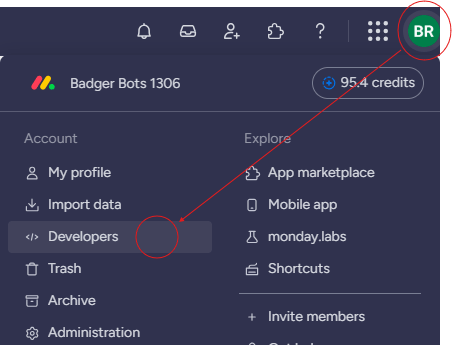
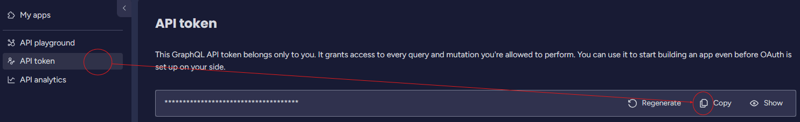

# monday-api

Monday API scripts

These scripts require **PowerShell 7 or later** (`pwsh`). They won't run in Windows
PowerShell 5.1, the `powershell.exe` that ships with Windows. Check your version with:

```powershell
$PSVersionTable.PSVersion
```

## Required software

- **PowerShell 7+**: [Windows](https://github.com/PowerShell/PowerShell/releases/download/v7.6.7/PowerShell-7.6.7-win-x64.msi) | [Mac](https://github.com/PowerShell/PowerShell/releases/download/v7.6.7/powershell-7.6.7-osx-arm64.pkg)
  - The Mac link is for Apple Silicon. For Intel Macs, use the [x64 installer](https://github.com/PowerShell/PowerShell/releases/download/v7.6.7/powershell-7.6.7-osx-x64.pkg).
  - These links are for 7.6.7. For other versions or install methods, see Microsoft's install guides for [Windows](https://learn.microsoft.com/powershell/scripting/install/installing-powershell-on-windows) and [Mac](https://learn.microsoft.com/powershell/scripting/install/installing-powershell-on-macos).
- **Git**: [Windows](https://git-scm.com/downloads/win) | [Mac](https://git-scm.com/downloads/mac)

## Recommended software

- **Visual Studio Code**: [Windows](https://update.code.visualstudio.com/latest/win32-x64-user/stable) | [Mac](https://update.code.visualstudio.com/latest/darwin-universal/stable)
  - Install the [PowerShell extension](https://marketplace.visualstudio.com/items?itemName=ms-vscode.PowerShell) to run and debug scripts with PowerShell 7.

## Getting started

```bash
git clone https://github.com/team1306/monday-api.git
cd monday-api
```

## Get a monday token

Every command takes your personal monday.com API token via `-Token`. The token
belongs only to you and grants access to every query and mutation your account is
allowed to perform.

1. Log in to monday.com, click your profile picture in the top right corner, and
   select **Developers**. The Developer Center opens in another tab.

   

2. Select **API token**, then click **Copy** to copy the token to your clipboard.
   Click **Show** if you want to see it first.

   

   Don't click **Regenerate** unless you mean to: it replaces the token and the
   old one stops working.

3. Paste the token into a `$token` variable in your PowerShell session:

   ```powershell
   $token = 'your-monday-api-token'
   ```

   **Never commit the token.** Set it in your terminal session rather than in a
   script file. If you put it in a file, keep that file out of git.

Account admins can also find the token under **Administration > Connections >
Personal API token**. See monday's
[authentication docs](https://developer.monday.com/api-reference/docs/authentication)
for details.

## Usage

Import the module from the repo root:

```powershell
Import-Module ./Monday -Force
```

Pass the `$token` from [Get a monday token](#get-a-monday-token) to each command.
See [AddEveryoneToAllBoards.ps1](AddEveryoneToAllBoards.ps1) for a full example.
For each board owned by the configured account, it adds every user as a subscriber
(members only on boards that aren't shareable, since guests can't be added there)
and adds the admins as owners:

```powershell
$token = 'eyJhbGciOiJI****'
./AddEveryoneToAllBoards.ps1
```

### Invoke-MondayApi

`Invoke-MondayApi` is the base command the others are built on. It sends any
GraphQL query or mutation to `https://api.monday.com/v2/` (API version `2026-07`)
and returns the response's `data` object, so you can call parts of the API that
don't have their own command yet:

```powershell
$data = Invoke-MondayApi -Query 'query { me { id name email } }' -Token $token
$data.me
```

If the API returns errors, they're written as a non-terminating error and nothing
is returned. For column value errors, the message includes the column id, type,
name, and value. Add `-ErrorAction Stop` to make errors stop the script.

### Defined commands

| Command | What it does |
|---|---|
| `Get-MondayUsers -Token` | Returns up to 1000 users with `id`, `name`, `email`, `created_at`, and `kind` (`member`, `admin`, `guest`, or `view_only`). |
| `Get-MondayBoards -Token` | Returns active, non-private boards (sub-item boards and documents excluded) from the first 50 boards, with `id`, `name`, `type`, `state`, `board_kind`, `owners`, and `subscribers`. |
| `Add-MondayUsersToBoard -Board -UserIds -Kind -Token` | Adds users to a board as `subscriber` or `owner`. `-Board` is a board object from `Get-MondayBoards`. Does nothing if `-UserIds` is empty. |

Run `Get-Help <command> -Full` for parameters and examples.

## More information

- [monday.com API docs](https://developer.monday.com/api-reference/docs/basics): how
  the monday API works, plus the
  [API reference](https://developer.monday.com/api-reference/reference/about-the-api-reference)
  for every query, mutation, and field you can use with `Invoke-MondayApi`.
- [Learn GraphQL](https://graphql.org/learn/): an introduction to GraphQL in general,
  the query language the monday API uses.

The **API playground** in the monday Developer Center (next to **API token**) is a
handy place to try out queries before putting them in a script.

## Line endings (Windows and macOS)

This repo is edited on both Windows and macOS. The [`.gitattributes`](.gitattributes)
file sets line endings per file type, whatever each machine's `core.autocrlf`
setting is. PowerShell files (`.ps1`, `.psm1`, `.psd1`, `.ps1xml`, `.pssc`, `.psrc`)
and `.bat`/`.cmd` are always checked out with CRLF; other text files use LF.

- If a file shows as changed even though you didn't edit it, run:

  ```bash
  git add --renormalize .
  ```
